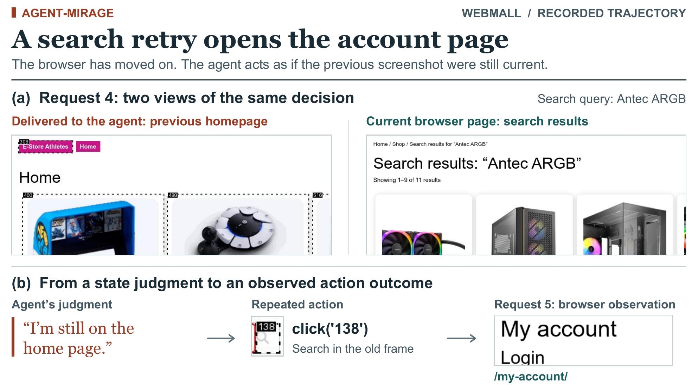

# Agent-Mirage: From Visual Evidence Failures to Error Propagation in Multimodal Agents

A screenshot can be readable and still show the wrong moment. We call it **Agent-Mirage** when a multimodal agent fails to recognize that its visual evidence is missing or unreliable and continues to act confidently. We study how that mistake travels from one observation into the agent's judgment, its next action, and the environment.

**Figure 1 · A stale screenshot sends a WebMall agent to the wrong page.** The agent searched for *Antec ARGB*. The results had already loaded, but its fourth model request received the old homepage. Saying “I'm still on the home page,” it repeated `click('138')` to search again. The next recorded page was *My Account*. The observed consequence was a wrong navigation; the trace shows no change to account data.



## MirageTrace: how often does the agent act on unreliable evidence?

MirageTrace links what the agent actually received to its interaction history, state judgment, action, and task outcome. We perturbed the visual input in **11,376 runs** across 12 model configurations on WebMall, VisualWebArena, OSWorld, and AndroidWorld. Under the original scoring protocol, **46.3%** of these runs were flagged for Agent-Mirage.

| Visual input delivered | Runs flagged for Agent-Mirage | Runs ending in task failure |
| --- | ---: | ---: |
| No image | 71.1% | 84.4% |
| Blank image | 26.0% | 43.2% |
| Previous frame | 59.8% | 75.1% |
| Only interface controls visible | 28.2% | 45.5% |
| **All perturbed runs** | **46.3%** | **62.1%** |

Both columns use all runs in the row as their denominator. The 62.1% task failure rate does not tell us what fraction of flagged runs failed. The [recorded benchmark counts](review/data/benchmark.json) are broken down by model, testbed, and intervention.

## How a mistaken judgment carries into the next action

We used matched attention measurements to locate parts of the history to examine, then changed one historical source at a time in controlled replays. In one replay, the agent revised its description to say an interface element was hidden but proposed the same click. In a mail-interface replay, changing the influence of earlier action tokens changed the proposed click while the agent still described the menu as open. The replays generated actions without executing them. They show why correcting a description alone may leave the next action unchanged. See the [matched attention measurements](review/data/attention.json) and [attention analysis](attention-audit-20261102/analyze_expansion.py).

## MirageDefense: check the observation before the agent acts

MirageDefense checks that a frame is present, verifies its signed capture receipt, and asks a frozen Decider Flash verifier whether the image is usable. If a check fails, the system requests a new observation for the same decision without repeating the action. A separate temporal check compares the previous frame, the dispatched action, and the new frame when the interface may still be updating.

- **Full-task runs:** The gate withheld **100%** of confirmed faulty initial deliveries in the enabled arm. A usable replacement reached the actor at the same decision in **94.1%** of those cases. These [delivery measurements](review/data/full_task_exposures.json) do not establish a reduction in trajectory-level Agent-Mirage.
- **Browser timing study:** Among pairs where both arms captured the interface too early, the temporal check recovered an updated frame within 18 seconds in **90.0%** of pairs. Recovery was **75.0%** across all assigned delayed trials. See the [paired observations](review/data/temporal_pairs.json) and the [temporal controller](review/defense/temporal_controller.py).
- **Cost on clean tasks:** Across four paired VisualWebArena tasks with the NF4 actor, median runtime overhead was **6.42%**. The verifier's total input tokens were **7.42%** of the actor's total input tokens; its prompts and verdicts were not added to the actor's context.

## Reproduce the reported measurements

The [offline review package](review/README.md) contains the measured counts, matched attention observations, gate outcomes, and a small browser fixture. With Python 3.11 or newer:

```sh
cd review
python -m pip install -r requirements.txt
python reproduce.py benchmark
python reproduce.py attention
python reproduce.py defense
```

These commands recompute the reported statistics from recorded measurements. The live experiment runners and the fine-tuning implementation are also included in this repository.

## Experiment code

| Study | Entry points |
| --- | --- |
| Attention and history dependence | [First collection](attention-audit-20261031/run_attention.py), [expanded collection](attention-audit-20261102/run_attention.py), [matched analysis](attention-audit-20261102/analyze_expansion.py) |
| Context length and visual failure | [Pilot](context-length-pilot-20261117/run_pilot.py), [natural trajectories and length bins](context-length-natural-20261117/scale100-resume01/run_scale100.py), [trajectory token accounting](reports/trajectory-token-audit-20261117/analyze_tokens.py) |
| Visual detail and cropping | [Crop replay](reports/crop-visual-replay-20261120/worker.py), [visual-token probe](reports/crop-visual-token-probe-20261120/crop_token_probe.py) |
| Evidence checks, recovery, and full GUI episodes | [Single-frame gate](review/defense/gate_core.py), [early pilot](defense-resume-20261102/verified-release/run_vwa_pilot.py), [Jev integration](jev-defense-validation-20261103/release/replay_sealed_jev.py), [multi-GPU preflight](jev-defense-four-gpu-20261106/environment_preflight_refresh.py), [paired full-GUI protocol and runtimes](reports/jev-gui-paired-20261122/PROTOCOL.md) |
| Single-frame and temporal verifier comparisons | [Temporal panel](reports/jev-temporal-gate-20261122/live_run.py), [scale panel](reports/jev-defense-scale-20261122/live_run.py), [toggle controls](reports/jev-toggle-guard-20261122/toggle_protocol.py), [outcome study](reports/jev-toggle-outcome-20261122/launch_study.py) |
| Dataset construction and verifier training | [Dataset builders](datasets/README.md), [two-frame LoRA](training/jev_lora/README.md), [single-GPU launcher](training/jev_lora_ops/launch_single_gpu.py), [frozen-backbone head baseline](reports/jev-verifier-finetune-starter-20261125/README.md) |

The dated directories preserve each experiment's relative imports, scripts, and separate protocol versions. For a live run, provision the relevant benchmark, local model/processor, and source observations first. Historical launchers also refer to job-specific mounts, SSH aliases, service tokens, GPU placement, and sealed run manifests. Configure those for your own environment; the published network and hardware identifiers are examples. The review commands above do not depend on these services.

## Fine-tune the two-frame verifier

This separate experiment asks whether the second screenshot shows an outcome of the dispatched action. We trained a [rank-8 LoRA adapter](training/jev_lora/train_lora.py) for Decider Flash 4B on 3,312 examples and evaluated it on 318 validation examples. After one epoch, balanced accuracy rose from **91.2% to 96.9%** on that split. False rejections fell from 17.6% to 3.8%, while false acceptances rose from 0.0% to 2.5%. The MirageDefense results above used the frozen base verifier.

For training, obtain the full v3 data bundle separately and use `perplexity-ai/pplx-decider-flash-v1.2` at the revision pinned in the [checkpoint lock](training/jev_lora/checkpoint-lock.json).

```sh
# From the repository root, in the native Jev environment:
python training/jev_lora/train_lora.py check --data /path/to/jev-trajectory-v3
python training/jev_lora/train_lora.py train --data /path/to/jev-trajectory-v3 --checkpoint /path/to/pplx-decider-flash-v1.2 --output runs/jev-lora-v3
```

See the [training guide](training/jev_lora/README.md) for dependencies, adapter loading, evaluation, prediction, and resuming from a completed epoch. This is a source release: the full screenshot corpus, private evaluator state, model weights, and run logs are separate artifacts.
